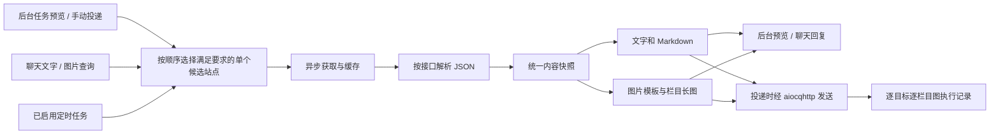

# 架构设计

当前已实现站点配置、任务私有栏目与有序候选站点、五类内容获取/缓存、文字和 Markdown、每栏目一张长图，以及后台手动投递、聊天查询和单循环调度。历史隔离验收使用真实宿主源码、假机器人和拦截请求；当前任务内栏目和候选站点新流程尚未在真实宿主验证，真实账号发送亦未验证。

## 数据流

## 模块边界

插件入口负责宿主装配和生命周期。领域模型负责站点、任务、任务私有栏目、校验和统一内容；适配器负责 endpoint 字段解析；应用服务负责获取、缓存、预览、调度和投递；渲染负责文字/图片；存储负责迁移和状态；宿主集成负责 Web API、消息及渲染接口。

这些是职责边界，不要求提前创建同名空目录。单个文件足够时不人为拆成多个包。

当前站点管理链路：

- `core/site_api.py`：站点管理用例的业务层，负责请求体到 `SiteCreate`/`SiteUpdate` 的映射、成功响应和校验/未找到/冲突/存储不可用的错误映射；不依赖宿主请求对象。
- `site_web.py`：宿主适配层，读取 Dashboard 请求、检查登录用户和插件启用状态，调用业务层并返回 `astrbot.api.web` 响应。
- `views/sites/`：无构建链的中文 HTML/CSS/JS 页面，通过宿主注入的 bridge 调用 API；凭据只提交、不回显。
- `main.py`：创建站点服务和上述组件，注册路由并维护打开/停用生命周期。

AstrBot 4.29.1 的视图 bridge 只有 `apiGet` 和 `apiPost`，因此更新和删除使用 POST 子路径：`GET/POST /<插件名>/sites`、`GET /<插件名>/sites/<id>`、`POST /<插件名>/sites/<id>/update`、`POST /<插件名>/sites/<id>/delete`。Dashboard 负责扩展路由鉴权；处理器仍检查用户名，并在插件未启用时拒绝读写。错误响应只返回稳定的公开消息和字段/版本信息，不返回堆栈、数据库路径或凭据。

当前内容获取链路：

- `core/content_client.py`：五种 endpoint 共用的 `httpx.AsyncClient`、有限重试、整体/连接/读取超时、流式大小限制、重定向拒绝和并发上限；不跟随重定向。客户端跟踪自己创建的请求任务，关闭时等待在途、排队和重试等待任务结束。
- `core/content_service.py`：持有一个共享客户端，组合五个适配器；五种预览共用连接池和全局并发预算，并通过 `ContentCache` 做有界缓存和同键获取合并。
- `core/content_cache.py`：进程内 TTL/LRU 缓存、站点 revision 隔离、每日新闻跨中国日期失效、强制刷新、等待取消和关闭清理；不持有或创建第二套 HTTP 客户端。
- `core/news.py` / `core/news_service.py`：每日新闻内容模型、日期/条目解析和 `/v2/60s` 获取。
- `core/bili.py` / `core/bili_service.py`：Bilibili 热搜内容模型、数组条目解析和 `/v2/bili` 获取。当前只使用 `title` 和可选 `link`，不生成排名、热度或更新时间。
- `core/zhihu.py` / `core/zhihu_service.py`：知乎热榜内容模型、数组条目解析和 `/v2/zhihu` 获取。只使用 `title`、可选 `detail`、原始 `hot_value_desc` 文本和可选 `link`；不渲染 `cover`，不生成排名或更新时间。
- `core/douyin.py` / `core/douyin_service.py`：抖音热搜内容模型、数组条目解析和 `/v2/douyin` 获取。只使用 `title`、可选原始整数 `hot_value` 和可选 `link`；不渲染 `cover`，不解释时间字段，不生成排名或更新时间。
- `core/toutiao.py` / `core/toutiao_service.py`：今日头条热榜内容模型、数组条目解析和 `/v2/toutiao` 获取。只使用 `title`、可选原始整数 `hot_value` 和可选 `link`；不渲染 `cover`，不生成排名、摘要、标签或更新时间。
- `core/content_api.py` / `content_web.py`：统一 `POST /<插件名>/content/preview`，只接受 `site_id` 和固定的 `content_type`（`daily_news`、`bilibili_hot`、`zhihu_hot`、`douyin_hot`、`toutiao_hot`）；未知类型在调用服务前拒绝，不能据此请求任意 URL。
- `core/news_api.py` / `news_web.py`：保留每日新闻旧接口 `POST /<插件名>/daily-news/preview`，继续接受站点 ID 并返回原有每日新闻快照；页面使用统一接口。
- `core/content_plan.py`：任务私有栏目方案的校验与转换；1～5 个不同类型，按序保存，条数为不限或 1～1000。
- `core/plan_preview.py`：对指定站点收集任务栏目，复核方案及站点 revision，并生成同源文字、Markdown 和图片快照；内部允许部分栏目失败。
- `core/candidate_preview.py` / `core/site_requirements.py`：按任务候选顺序尝试，只有同一站点所有栏目成功且满足指定条数才选用；不限条数时合法空列表可满足要求。
- `core/profile_render.py`：纯函数文字/Markdown 渲染，不依赖 AstrBot、HTTP、数据库或浏览器；只读取已截取的预览响应，不修改快照或缓存。
- `core/source_url.py`：来源地址的规范化。`sanitize_source_url` 只保留 http(s) 协议、主机、端口和路径，去掉用户信息、查询串和 fragment，拒绝控制字符与不可展示字符；`snapshot_source_url` 使用 httpx 的 URL 规范化，去除用户信息、查询串和 fragment，不可安全表达时返回空来源；`source_domain_text` 只取域名（IPv6 保留方括号）供对外展示；无法展示时统一返回“来源不可用”。
- `core/image_snapshots.py`：进程内短期图片快照，TTL 300 秒/最多 32 个/总 8 MiB；保存已验证的截图输入、方案/站点 revision 和用户归属，不保存 HTML 或文件路径；栏目数据包含来源地址；URL 用户信息、查询串和 fragment 已去除，但路径可能包含敏感信息。
- `core/profile_image.py`：Pillow 固定样式中文长图渲染器，一个栏目一张；只读快照数据，按字符宽度换行，宽度固定 900px、高度随内容增长（上限 8000px，单张 PNG 上限 2 MiB，栏目最多 5 个，单栏文本 200,000 字符），不加载远程资源；逐栏失败码为 `section_too_long` / `section_too_tall` / `section_too_large`，累计字节超限后剩余栏目记 `total_bytes_exceeded`；栏目数超过 5 个抛 `ImageLimitError`，由 API 映射为 422 `image_limit_exceeded`；不截断、不拆图。
- `core/tasks.py`：推送任务领域模型、私有栏目、有序候选站点、输出方式、完整 UMO 校验和 revision CRUD；不持有 HTTP 客户端或发送接口。
- `core/task_api.py` / `task_web.py`：任务 CRUD 的安全 API 映射和 Dashboard 宿主适配；支持任务预览、图片生成、每日/每周/间隔/五字段 Cron 计划及理论时间预览；启停使用专门接口。
- `core/schedule.py`：每日、每周、间隔和五字段 Cron 计划模型、校验及时刻计算。
- `core/scheduler.py`：显式启停、60 秒迟到窗口、单循环到期检查、事务认领、跳过记录和生命周期关闭；外部投递在锁外执行。
- `core/chat_commands.py` / `core/chat_content.py` / `core/chat_image.py`：聊天帮助、白名单内任务列表及文字/图片内容查询；查询前后通过任务服务读取同一 SiteStore 锁内的配置快照，校验完整 UMO、引用关系和版本。内容复用缓存与纯文字渲染，入口在回复前检查生命周期代次，不调用投递服务。
- `core/delivery.py`：投递核心。读取已保存任务的栏目、候选、输出和白名单，复用 `PlanPreview` 与图片快照，从满足条件的单个站点准备共享内容；手动投递和调度调用同一服务，逐目标逐栏目图持久化状态。投递有总截止时间，并为后续候选和发送预留时间；启动不发送、不补发。
- `core/delivery_api.py` / `delivery_web.py`：手动投递确认、提交和执行记录查询；校验 Dashboard 身份、插件状态、执行标识及任务/方案/站点 revision。公开投影不返回 owner token、凭据、正文、PNG 或内部路径。列表支持有界分页和 task_id 筛选，页面通过 bridge params 传递分页条件。
- `core/astrbot_sender.py`：AstrBot v4.29.1 aiocqhttp/OneBot v11 适配。按 UMO 平台实例 ID 精确查找实例，用真实 `Context.send_message`/`MessageSession`/`MessageChain` 路由；仅接受 aiocqhttp，其他适配器前置拒绝；图片用内存 PNG bytes，Markdown 以 Plain 源码发送。
- `core/image_service.py`：受限线程池（最多 2 执行、4 排队，准入 6）、20 秒总超时、取消事件和关闭等待；后台任务结束前持续占用准入名额，避免超时后无界积压。
- `core/site_store.py`：同一 SQLite 连接管理站点、任务私有方案与栏目、候选站点、UMO、调度及投递记录。从 v16 起使用 `content_profiles` / `content_profile_items` 存储私有方案，当前 schema v19 沿用这一结构：方案 ID 等于任务 ID；旧组合行保留，不再作为共享可编辑实体。站点候选被引用时受删除保护。
- v16 旧库迁移：先取得 SQLite 写锁并重新读取版本，在事务中为每个旧任务建立同 ID 的方案，将旧组合栏目按顺序复制到各任务，随后将任务的 `profile_id` 指向自身；原组合数据保留，历史投递记录不被改写。更早的旧库会按原组合站点回填候选，旧站点无来源类型时设为 `public`。迁移失败回滚；升级前应停用并备份数据库。
- 任务预览：`core/task_api.py` 从已保存的启用候选按顺序查找；`PlanPreview` 对单站逐栏目取数并按条数截取，收齐后复核方案和站点 revision，最多两轮，不一致返回 409 `preview_revision_changed`。候选选择要求全部栏目及条数满足，失败或不足则尝试下一个，不混合站点；全部不满足则返回错误。文字和 Markdown 来自选定预览，后台可显式刷新上游。
- 任务图片：从同次预览保存结构化栏目至 `ImageSnapshotStore`，按不透明 ID、归属及方案/站点 revision 校验后在线程池渲染；不重新请求上游或读取后续缓存。每栏目一条图片记录，后台经认证 JSON 接收 PNG base64 并逐张展示或下载。
- `views/sites/`：在站点管理页内提供“内容预览”，选择站点和内容类型后主动获取；结果用安全 DOM 文本渲染，不写入站点配置，也不进入站点写操作的未确认流程。

公共快照字段为来源站点、内容类型、endpoint、来源地址（`source_url`，不可表达时为空）、站点来源类型（`source_kind`：`public` / `self_built`）和获取时间；每日新闻另有内容日期、旧/未知日期警告、有序新闻条目、微语和来源链接。Bilibili 热搜另有有序标题/链接条目和实际条数；知乎热榜另有有序标题、摘要、原始热度文本、链接和实际条数；抖音热搜另有有序标题、原始整数热度、链接和实际条数；今日头条热榜另有有序标题、原始整数热度、链接和实际条数，没有排名、摘要、标签或更新时间字段。五种快照不共享字段语义，不把抓取时间当内容日期或更新时间，也不把列表序号当排名。

每日新闻使用 `/v2/60s`，Bilibili 热搜使用 `/v2/bili`，知乎热榜使用 `/v2/zhihu`，抖音热搜使用 `/v2/douyin`，今日头条热榜使用 `/v2/toutiao`，均保留站点基础路径前缀。每日新闻 `data.news: []`、Bilibili/知乎/抖音/今日头条 `data: []` 都是合法空内容；必要结构错误则整次解析失败。预览内容不持久化到数据库或磁盘；当前使用进程内缓存，停用/重载清空，进程重启不会恢复。任务私有栏目、有序候选站点、推送任务（含每日/每周/间隔/Cron 计划）、任务 UMO、运行计划、认领/跳过记录和投递执行/目标/页持久化在 SQLite schema v19；任务配置不保存内容快照，投递只保存计划、摘要/哈希和结果，不保存完整正文或 PNG。

## 实现默认选择

- 异步 Python 3.12；AstrBot 基线 v4.29.1，详见开发手册的兼容性基线。
- 使用一个异步 HTTP 客户端，明确依赖约束。
- 站点由 `core/sites.py` 和 `core/site_store.py` 管理；任务、栏目及候选由 `core/tasks.py`、`core/content_plan.py`、`core/task_api.py` 和 `task_web.py` 管理。`core/plan_preview.py` 与 `core/candidate_preview.py` 支撑后台、聊天和投递，文字/图片渲染及调度复用上述快照。
- SQLite 在宿主插件数据目录保存站点、任务私有方案及投递执行/目标/页记录；删除任务不删除既有执行记录。
- 少量全局设置使用 AstrBot 配置 schema；业务实体只有一个持久化真源。
- 后台使用宿主插件视图及 bridge，当前站点页采用简单 HTML/CSS/JS，不引入 CDN、外部字体或独立服务器。
- 图片使用 Pillow 和宿主可验证的 CJK 字体，渲染器不调用宿主 Web/消息 API；字体环境缺失时明确报错，文字/Markdown 保持可用。
- 实际调度使用单实例有界循环；支持每日、每周 ISO 星期、间隔和五字段 Cron 计划，迟到窗口固定 60 秒。

## 生命周期

启动：验证 → 数据迁移 → 打开内容客户端 → 宿主集成。调度启动后先丢弃已过期计划，再进入单个有界等待循环；重载/停用关闭旧循环。同一实例重新初始化会重建图片、快照、PlanPreview、聊天、投递、调度和对应 Web API，旧处理器不再持有失效资源。
配置更新：验证并事务保存站点和任务；普通任务编辑自动停用并删除运行计划，需要管理员重新启用。启用/禁用通过与任务 revision 绑定的鉴权 API。
停用/重载：置为未启用 → 关闭调度循环 → 关闭投递服务并等待自有任务清理 → 关闭图片服务（取消/等待渲染线程）→ 清空图片快照 → 关闭内容客户端 → 关闭存储。

当前存储在插件 `initialize()` 中打开并迁移至 SQLite schema v19，随后打开共享内容客户端并启动调度循环。初始化失败时依次关闭调度、投递、图片、快照、内容和存储资源。`terminate()` 按上面的停用顺序释放资源。各 Web API 在 `__init__` 中注册，初始化完成前及停用后通过实例启用标志拒绝调用；重载时同路由同方法替换旧处理器。投递执行在关闭、取消或重开后保留已知结果；未开始项记 skipped，可能进入外部调用的项保守记 unknown，不恢复发送。

4.29.1 的停用/重载会调用插件 `terminate()`（插件类自身定义 `__del__` 时优先）并解绑处理器；同路由同方法的 Web API 会替换。新增注册项仍须按目标版本源码和实测逐项核验。投递核心已在外部调用前重新检查配置和白名单；已移除目标不会继续接收尚未开始的页。

## 缓存与快照

统一预览使用进程内缓存：默认 TTL 300 秒、最多 32 项、LRU 淘汰；仅缓存成功快照（含合法空列表），错误不缓存。键包含站点 ID、内容类型、明确空参数和站点 revision；凭据不进入键。站点停用/删除在读取前拒绝；配置修改增加 revision，旧版本快照不会被新版本复用。每日新闻跨中国日期后强制失效并重新获取。普通获取命中有效缓存时不请求上游；强制刷新绕过缓存但可复用同键在途获取。同键获取合并，等待者有上限，单个等待者取消不影响其他等待者；关闭时取消并等待缓存自有任务后清空。共享客户端最多允许 2 个并发请求。

`source_url` 在获取成功时由服务层写入快照：使用 httpx 的 URL 规范化，保留非默认端口、路径前缀和 endpoint，去掉用户信息、查询串和 fragment；路径点段和默认端口遵循客户端规则。编码后快照预算为 25088 字符，按站点基础地址上限 2048 字符乘以 UTF-8 最坏百分号编码膨胀 12 倍并加余量计算；无法安全表达时返回空来源。同一快照记录站点当时的 `source_kind`。展示规则统一由 `source_display_text` 决定：`public` 只显示域名（不显示协议、端口、路径、查询串或凭据），`self_built` 只显示“自建服务”，未知类型有地址时按自建隐藏、没有地址时写“来源不可用”。文字、Markdown、图片页脚、聊天和后台栏目投影都调用这一个函数，因此五类接口与各出口使用同一条规则；后台受鉴权接口返回快照中的 `source_url`，管理员可在站点管理中核对完整基础地址。后续站点改名、改地址或改来源类型只影响新获取，已生成快照、文字、Markdown 和图片快照继续使用获取时的值，不按站点名称或 endpoint 补造。

单站预览按任务顺序返回栏目，逐栏按 `limit` 截取，不修改缓存中的完整快照；合法空列表为成功响应。每站最多两轮：收齐后复核方案和站点 revision，变化则丢弃整轮并重试，仍不一致返回 409。复核后到响应发出之间仍有配置变化窗口。底层预览可保留部分成功栏目；任务预览、聊天与投递进一步要求单个候选满足全部栏目和条数，不将多个站点的成功栏目拼接。文字和 Markdown 由同一预览生成，图片快照另保存方案/站点 revision、归属和过期时间。

## 错误与恢复

区分网络超时、HTTP/业务错误、非法 JSON、结构变化、响应过大、重定向、旧数据和空内容。内容预览失败不会保存站点、删除站点或进入站点写操作的未确认流程；旧内容、每日新闻空内容、Bilibili/知乎/抖音/今日头条空列表仍是成功预览。部分栏目失败不等于整份成功。

执行键：任务 ID + 计划时间 UTC；发送记录细分目标 UMO + 页号。成功页不重发。

外部发送与本地写库无法组成原子事务。发送超时或发送后写库前崩溃时标记 unknown，默认不自动重发，避免假承诺 exactly-once。

重启默认恢复未来计划，不集中补发离线任务。日报迟到重试有截止时间，沿用原执行键。

## 接口适配

每个 endpoint 定义 ID、中文名称、相对路径、参数校验、JSON 结构及缓存建议。只请求选中的接口；不把所有返回值当 data.news。

文档存在、夹具通过、真实宿主通过和真实上游通过是不同状态。当前只适配每日新闻 `/v2/60s`、Bilibili 热搜 `/v2/bili`、知乎热榜 `/v2/zhihu`、抖音热搜 `/v2/douyin` 和今日头条热榜 `/v2/toutiao`，不展示其他接口选项。新接口须补充正常/空数据/错误类型夹具、宿主预览和真实来源核验；不得把示例站点写成默认启用配置。
