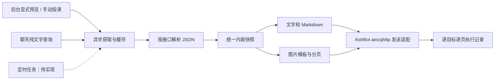

# 架构设计

当前已实现站点、组合和任务配置，五类内容获取/缓存，组合文字、Markdown 和分页图片，以及 Dashboard 手动投递和执行记录。发送通过 aiocqhttp 适配层，隔离验收使用真实宿主源码、假机器人和拦截请求；真实账号发送未验证。聊天帮助/列表、纯文字和图片查询已实现；每日计划配置和理论时间预览已实现，实际调度执行仍为后续设计。

## 数据流

## 模块边界

插件入口负责宿主装配和生命周期。领域模型负责站点、组合、任务、校验和统一内容；适配器负责 endpoint 字段解析；应用服务负责获取、缓存、预览、调度和投递；渲染负责文字/图片；存储负责迁移和状态；宿主集成负责 Web API、消息及渲染接口。

这些是职责边界，不要求提前创建同名空目录。单个文件足够时不人为拆成多个包。

当前站点管理链路：

- `core/site_api.py`：站点管理用例的业务层，负责请求体到 `SiteCreate`/`SiteUpdate` 的映射、成功响应和校验/未找到/冲突/存储不可用的错误映射；不依赖宿主请求对象。
- `site_web.py`：宿主适配层，读取 Dashboard 请求、检查登录用户和插件启用状态，调用业务层并返回 `astrbot.api.web` 响应。
- `views/sites/`：无构建链的中文 HTML/CSS/JS 页面，通过宿主注入的 bridge 调用 API；凭据只提交、不回显。
- `main.py`：创建站点服务和上述组件，注册路由并维护打开/停用生命周期。

AstrBot 4.29.1 的视图 bridge 只有 `apiGet` 和 `apiPost`，因此更新和删除使用 POST 子路径：`GET/POST /<插件名>/sites`、`GET /<插件名>/sites/<id>`、`POST /<插件名>/sites/<id>/update`、`POST /<插件名>/sites/<id>/delete`。Dashboard 负责扩展路由鉴权；处理器仍检查用户名，并在插件未启用时拒绝读写。错误响应只返回稳定的公开消息和字段/版本信息，不返回堆栈、数据库路径或凭据。

当前内容获取链路：

- `core/content_client.py`：五种 endpoint 共用的 `httpx.AsyncClient`、有限重试、整体/连接/读取超时、流式大小限制、重定向拒绝和并发上限；不跟随重定向。客户端跟踪自己创建的请求任务，关闭时等待在途、排队和重试等待任务结束。
- `core/content_service.py`：持有一个共享客户端，组合五个适配器；五种预览共用连接池和全局并发预算，并通过 `ContentCache` 做有界缓存和同键获取合并。
- `core/content_cache.py`：进程内 TTL/LRU 缓存、站点 revision 隔离、每日新闻跨中国日期失效、强制刷新、等待取消和关闭清理；不持有或创建第二套 HTTP 客户端。
- `core/news.py` / `core/news_service.py`：每日新闻内容模型、日期/条目解析和 `/v2/60s` 获取。
- `core/bili.py` / `core/bili_service.py`：Bilibili 热搜内容模型、数组条目解析和 `/v2/bili` 获取。当前只使用 `title` 和可选 `link`，不生成排名、热度或更新时间。
- `core/zhihu.py` / `core/zhihu_service.py`：知乎热榜内容模型、数组条目解析和 `/v2/zhihu` 获取。只使用 `title`、可选 `detail`、原始 `hot_value_desc` 文本和可选 `link`；不渲染 `cover`，不生成排名或更新时间。
- `core/douyin.py` / `core/douyin_service.py`：抖音热搜内容模型、数组条目解析和 `/v2/douyin` 获取。只使用 `title`、可选原始整数 `hot_value` 和可选 `link`；不渲染 `cover`，不解释时间字段，不生成排名或更新时间。
- `core/toutiao.py` / `core/toutiao_service.py`：今日头条热榜内容模型、数组条目解析和 `/v2/toutiao` 获取。只使用 `title`、可选原始整数 `hot_value` 和可选 `link`；不渲染 `cover`，不生成排名、摘要、标签或更新时间。
- `core/content_api.py` / `content_web.py`：统一 `POST /<插件名>/content/preview`，只接受 `site_id` 和固定的 `content_type`（`daily_news`、`bilibili_hot`、`zhihu_hot`、`douyin_hot`、`toutiao_hot`）；未知类型在调用服务前拒绝，不能据此请求任意 URL。
- `core/news_api.py` / `news_web.py`：保留每日新闻旧接口 `POST /<插件名>/daily-news/preview`，继续接受站点 ID 并返回原有每日新闻快照；页面使用统一接口。
- `core/profiles.py`：内容组合领域模型、栏目校验、revision CRUD 和站点存在性检查；允许保存已停用站点，预览前再拒绝。
- `core/profile_api.py` / `profile_web.py`：组合 CRUD、组合预览、部分/全部失败映射和后台 API 宿主适配。
- `core/profile_render.py`：纯函数文字/Markdown 渲染，不依赖 AstrBot、HTTP、数据库或浏览器；只读取已截取的预览响应，不修改快照或缓存。
- `core/image_snapshots.py`：进程内短期图片快照，TTL 300 秒/最多 32 个/总 8 MiB；保存已验证的截图输入、组合/站点 revision 和用户归属，不保存 HTML、URL 或文件路径。
- `core/profile_image.py`：Pillow 固定样式中文分页渲染器；只读快照数据，按字符宽度换行并逐行分页，生成 900×1200 RGB PNG，不加载远程资源。
- `core/tasks.py`：推送任务领域模型、输出方式、完整 UMO 校验、revision CRUD 和组合引用保护；不持有 HTTP 客户端或发送接口。
- `core/task_api.py` / `task_web.py`：任务 CRUD 的安全 API 映射和 Dashboard 宿主适配；支持可选每日计划及理论时间预览，拒绝启用、运行状态和调度状态字段。
- `core/schedule.py`：不可变每日计划模型、严格 IANA/时间解析和纯函数下次时间计算；不启动调度器、不写运行状态。
- `core/chat_commands.py` / `core/chat_content.py`：聊天帮助、白名单内任务列表及纯文字内容查询；查询前后通过任务服务读取同一 SiteStore 锁内的配置快照，校验完整 UMO、引用关系和版本。内容复用缓存与纯文字渲染，入口在回复前检查生命周期代次，不调用投递服务。
- `core/delivery.py`：手动投递核心。只接受已保存任务 ID 和执行标识，读取组合/输出/白名单；复用 ProfileApi 的预览与图片快照，一次准备共享内容；调用注入的 `DeliverySender`，逐目标逐页持久化状态。插件入口注入 aiocqhttp 适配层，只有 Dashboard 鉴权的显式测试操作启动执行；启动不发送、不补发。
- `core/delivery_api.py` / `delivery_web.py`：手动投递确认、提交和执行记录查询；校验 Dashboard 身份、插件状态、执行标识及任务/组合/站点 revision。公开投影不返回 owner token、凭据、正文、PNG 或内部路径。列表支持有界分页和 task_id 筛选，页面通过 bridge params 传递分页条件。
- `core/astrbot_sender.py`：AstrBot v4.29.1 aiocqhttp/OneBot v11 适配。按 UMO 平台实例 ID 精确查找实例，用真实 `Context.send_message`/`MessageSession`/`MessageChain` 路由；仅接受 aiocqhttp，其他适配器前置拒绝；图片用内存 PNG bytes，Markdown 以 Plain 源码发送。
- `core/image_service.py`：受限线程池（最多 2 执行、4 排队，准入 6）、20 秒总超时、取消事件和关闭等待；后台任务结束前持续占用准入名额，避免超时后无界积压。
- `core/site_store.py`：同一 SQLite 连接管理站点、组合、栏目、推送任务、任务 UMO 和投递执行/目标/页；schema v6 事务迁移、外键 `ON DELETE RESTRICT`、组合引用删除拒绝、任务 revision 控制和投递状态恢复。
- 组合预览：`core/profile_api.py` 读取一份组合版本和站点，按栏目配置顺序调用 `ContentService.preview_cached`；只请求选中类型，复用缓存和并发预算，逐栏截取返回条数，不修改完整快照。
- 组合文字输出：预览成功或部分成功后，`core/profile_render.py` 基于同一份响应生成 `outputs.text` 和 `outputs.markdown`；后台只切换/复制/下载已接受响应，不再次获取。全部失败不生成输出。
- 组合图片：预览成功后，`core/profile_api.py` 将同一次响应的结构化栏目保存到 `ImageSnapshotStore` 并返回不透明 ID。生成时根据 ID 取回快照，校验用户、组合/站点 revision 和启用状态，再由 `ProfileImageService` 在线程池中调用 `ProfileImageRenderer`；不重新请求上游、不读取后续缓存。图片以认证 JSON 的 PNG base64 返回，后台用 data URL 展示和逐页下载，不使用静态文件路径。
- `views/sites/`：在站点管理页内提供“内容预览”，选择站点和内容类型后主动获取；结果用安全 DOM 文本渲染，不写入站点配置，也不进入站点写操作的未确认流程。

公共快照字段为来源站点、内容类型、endpoint 和获取时间；每日新闻另有内容日期、旧/未知日期警告、有序新闻条目、微语和来源链接。Bilibili 热搜另有有序标题/链接条目和实际条数；知乎热榜另有有序标题、摘要、原始热度文本、链接和实际条数；抖音热搜另有有序标题、原始整数热度、链接和实际条数；今日头条热榜另有有序标题、原始整数热度、链接和实际条数，没有排名、摘要、标签或更新时间字段。五种快照不共享字段语义，不把抓取时间当内容日期或更新时间，也不把列表序号当排名。

每日新闻使用 `/v2/60s`，Bilibili 热搜使用 `/v2/bili`，知乎热榜使用 `/v2/zhihu`，抖音热搜使用 `/v2/douyin`，今日头条热榜使用 `/v2/toutiao`，均保留站点基础路径前缀。每日新闻 `data.news: []`、Bilibili/知乎/抖音/今日头条 `data: []` 都是合法空内容；必要结构错误则整次解析失败。预览内容不持久化到数据库或磁盘；当前使用进程内缓存，停用/重载清空，进程重启不会恢复。内容组合、栏目、推送任务（含可选每日计划）、任务 UMO 和投递执行/目标/页持久化在 SQLite schema v6；组合不复制内容快照，任务不复制组合内容，投递只保存计划、摘要/哈希和结果，不保存完整正文或 PNG。

## 实现默认选择

- 异步 Python 3.12；AstrBot 基线 v4.29.1，详见开发手册的兼容性基线。
- 使用一个异步 HTTP 客户端，明确依赖约束。
- 站点配置由 `core/sites.py`（校验与站点服务）和 `core/site_store.py`（SQLite/aiosqlite）实现；内容组合由 `core/profiles.py`、`core/profile_api.py`、`profile_web.py` 管理，数据复用同一 `SiteStore`；后台管理由 `core/site_api.py`、`site_web.py` 和 `views/sites/` 实现。内容获取由 `core/content_client.py`、`core/content_service.py`、`core/news.py`、`core/news_service.py`、`core/bili.py`、`core/bili_service.py`、`core/zhihu.py`、`core/zhihu_service.py`、`core/douyin.py`、`core/douyin_service.py`、`core/toutiao.py`、`core/toutiao_service.py`、`core/content_api.py`、`core/news_api.py`、`content_web.py` 和 `news_web.py` 实现；组合和站点引用关系已实现；任务和逐目标逐页记录已持久化，后台手动投递已接入 aiocqhttp；组合文字/Markdown 和分页图片已实现。聊天纯文字和图片查询已实现；每日计划配置与理论预览已实现，实际调度未实现。
- SQLite 在宿主插件数据目录保存站点、组合、任务及投递执行/目标/页记录；删除任务不删除既有执行记录。
- 少量全局设置使用 AstrBot 配置 schema；业务实体只有一个持久化真源。
- 后台使用宿主插件视图及 bridge，当前站点页采用简单 HTML/CSS/JS，不引入 CDN、外部字体或独立服务器。
- 图片使用 Pillow 和宿主可验证的 CJK 字体，渲染器不调用宿主 Web/消息 API；字体环境缺失时明确报错，文字/Markdown 保持可用。
- 实际调度尚未实现；当前只保存每日计划和计算理论下次时间。设计上采用单实例确定性调度，不依赖大模型任务工具。

## 生命周期

启动：验证 → 数据迁移 → 打开内容客户端 → 宿主集成。当前没有后台调度循环或调度恢复流程。
配置更新：验证并事务保存站点、组合和任务（含可选每日计划）；保存不触发获取或投递，不创建定时执行计划。
停用/重载：置为未启用 → 关闭投递服务并等待自有任务清理 → 关闭图片服务（取消/等待渲染线程）→ 清空图片快照 → 关闭内容客户端 → 关闭存储。

当前存储在插件 `initialize()` 中打开并迁移至 SQLite schema v6，随后打开共享内容客户端。内容客户端打开失败时依次关闭投递、内容、图片、快照和存储资源。`terminate()` 按上面的停用顺序释放资源。各 Web API 在 `__init__` 中注册，初始化完成前及停用后通过实例启用标志拒绝调用；重载时同路由同方法替换旧处理器。投递执行在关闭、取消或重开后保留已知结果；未开始项记 skipped，可能进入外部调用的项保守记 unknown，不恢复发送。

4.29.1 的停用/重载会调用插件 `terminate()`（插件类自身定义 `__del__` 时优先）并解绑处理器；同路由同方法的 Web API 会替换。新增注册项仍须按目标版本源码和实测逐项核验。投递核心已在外部调用前重新检查配置和白名单；已移除目标不会继续接收尚未开始的页。

## 缓存与快照

统一预览使用进程内缓存：默认 TTL 300 秒、最多 32 项、LRU 淘汰；仅缓存成功快照（含合法空列表），错误不缓存。键包含站点 ID、内容类型、明确空参数和站点 revision；凭据不进入键。站点停用/删除在读取前拒绝；配置修改增加 revision，旧版本快照不会被新版本复用。每日新闻跨中国日期后强制失效并重新获取。普通获取命中有效缓存时不请求上游；强制刷新绕过缓存但可复用同键在途获取。同键获取合并，等待者有上限，单个等待者取消不影响其他等待者；关闭时取消并等待缓存自有任务后清空。共享客户端最多允许 2 个并发请求。

组合预览按配置顺序返回栏目，逐栏按 `limit` 截取响应，不修改缓存中的完整快照；合法空列表算成功。部分栏目失败保留成功栏目并返回安全错误，全部失败返回 502 且不显示为空内容成功。文字/Markdown 只从已截取结果生成，不单独访问上游；Markdown 对不可信文本/链接做转义，不输出 HTML、图片或远程资源。同次输出共享不可变快照；图片快照额外保存组合/站点 revision、归属和过期时间，容量/TTL/关闭清理在内存中完成，不创建图片文件。

## 错误与恢复

区分网络超时、HTTP/业务错误、非法 JSON、结构变化、响应过大、重定向、旧数据和空内容。内容预览失败不会保存站点、删除站点或进入站点写操作的未确认流程；旧内容、每日新闻空内容、Bilibili/知乎/抖音/今日头条空列表仍是成功预览。部分栏目失败不等于整份成功。

执行键：任务 ID + 计划时间 UTC；发送记录细分目标 UMO + 页号。成功页不重发。

外部发送与本地写库无法组成原子事务。发送超时或发送后写库前崩溃时标记 unknown，默认不自动重发，避免假承诺 exactly-once。

重启默认恢复未来计划，不集中补发离线任务。日报迟到重试有截止时间，沿用原执行键。

## 接口适配

每个 endpoint 定义 ID、中文名称、相对路径、参数校验、JSON 结构及缓存建议。只请求选中的接口；不把所有返回值当 data.news。

文档存在、夹具通过、真实宿主通过和真实上游通过是不同状态。当前只适配每日新闻 `/v2/60s`、Bilibili 热搜 `/v2/bili`、知乎热榜 `/v2/zhihu`、抖音热搜 `/v2/douyin` 和今日头条热榜 `/v2/toutiao`，不展示其他接口选项。新接口须补充正常/空数据/错误类型夹具、宿主预览和真实来源核验；不得把示例站点写成默认启用配置。
