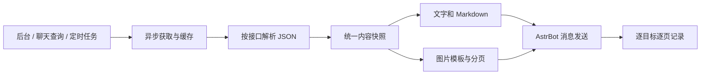

# 架构设计

当前为设计约定，模块在实现相应功能时按需建立。

## 数据流

## 模块边界

插件入口负责宿主装配和生命周期。领域模型负责站点、组合、任务、校验和统一内容；适配器负责 endpoint 字段解析；应用服务负责获取、缓存、预览、调度和投递；渲染负责文字/图片；存储负责迁移和状态；宿主集成负责 Web API、消息及渲染接口。

这些是职责边界，不要求提前创建同名空目录。单个文件足够时不人为拆成多个包。

## 实现默认选择

- 异步 Python；具体 Python/AstrBot 版本先核验。
- 使用一个异步 HTTP 客户端，明确依赖约束。
- SQLite 存复杂业务实体与发送记录，位置在宿主插件数据目录。
- 少量全局设置使用 AstrBot 配置 schema；业务实体只有一个持久化真源。
- 后台使用宿主插件视图及 bridge，优先简单 HTML/CSS/JS，按复杂度再决定框架。
- 图片接入经验证可用的宿主渲染能力，默认准备文字降级策略。
- 单实例确定性调度，不依赖大模型任务工具。

## 生命周期

启动：验证 → 数据迁移 → 客户端/宿主集成 → 恢复未来计划。
配置更新：验证并事务保存 → 更新受影响计划。失败不留下半配置。
停用/重载：停止新执行 → 取消并等待旧任务 → 释放网络/渲染资源 → 关闭存储。

宿主注册项如何注销以目标版本源码和实测为准。发送前重新检查任务状态和白名单，已移除目标不得继续接收剩余页。

## 缓存与快照

请求缓存键包含站点、接口、规范化参数和认证/配置版本，避免跨站点串数据。相同请求合并，限制并发。

同次输出共享不可变快照；图片缓存额外包含模板版本、主题和分页参数。清理有容量/保留期，不能删除在途文件。

## 错误与恢复

区分网络超时、HTTP/业务错误、非法 JSON、字段变化、旧数据、渲染错误、平台不可用、投递结果未知。部分栏目失败不等于整份成功。

执行键：任务 ID + 计划时间 UTC；发送记录细分目标 UMO + 页号。成功页不重发。

外部发送与本地写库无法组成原子事务。发送超时或发送后写库前崩溃时标记 unknown，默认不自动重发，避免假承诺 exactly-once。

重启默认恢复未来计划，不集中补发离线任务。日报迟到重试有截止时间，沿用原执行键。

## 接口适配

每个 endpoint 定义 ID、中文名称、相对路径、参数校验、JSON 结构及缓存建议。只请求选中的接口；不把所有返回值当 data.news。

文档存在、夹具通过和真实站点通过是三个不同状态。未适配接口不开放选择。新接口须补充正常/空数据/错误类型夹具与图文输出检查。
